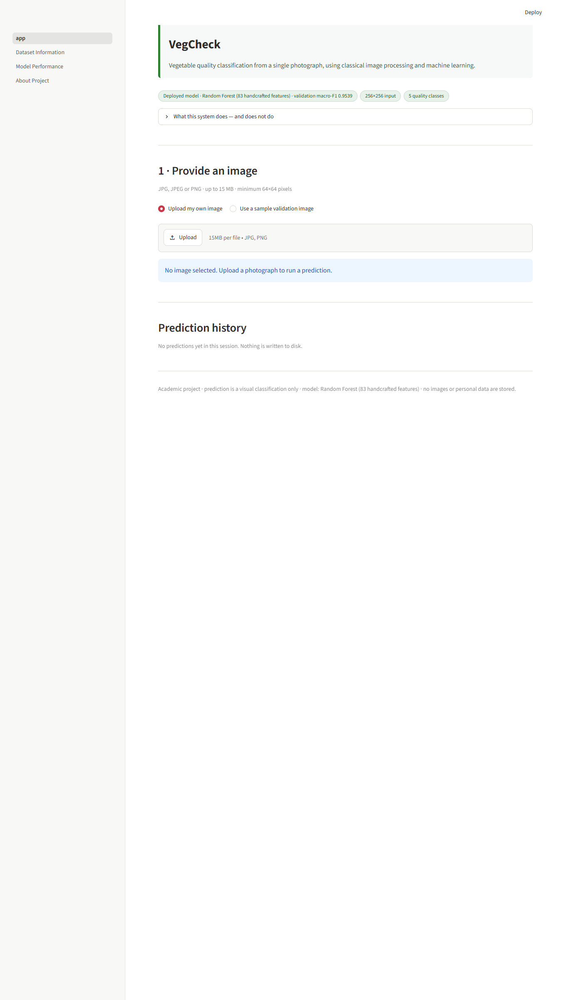
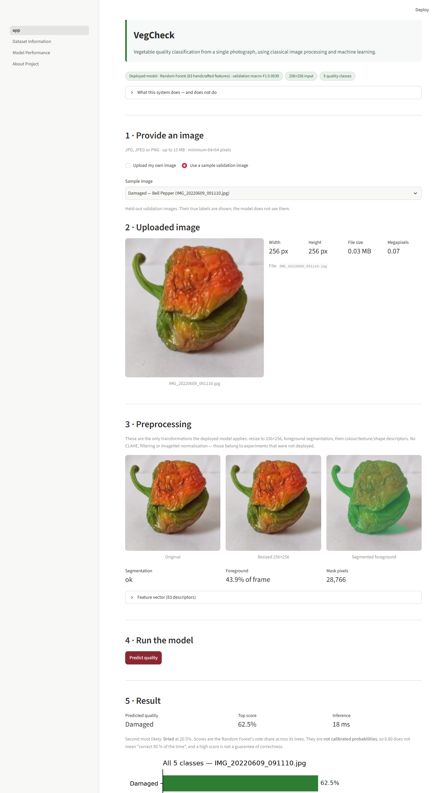
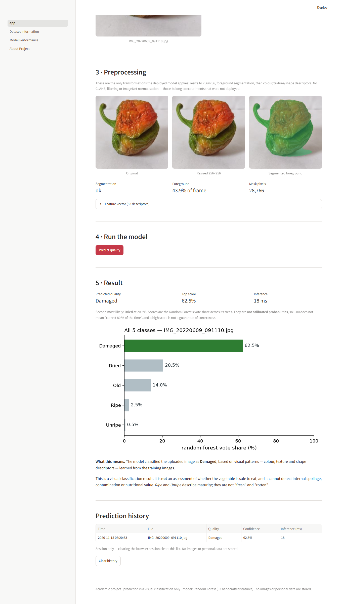
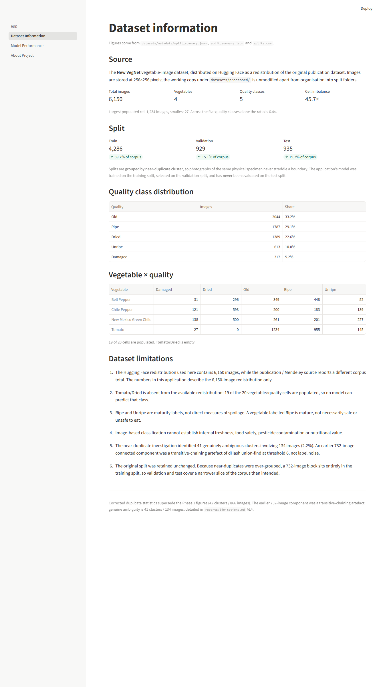
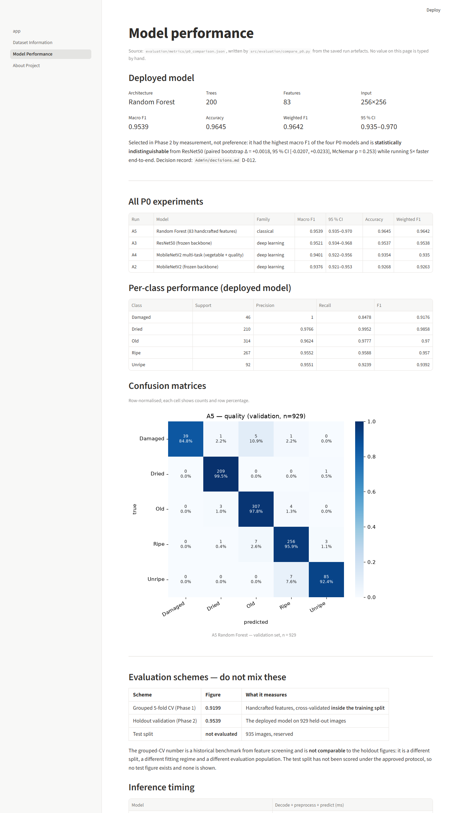
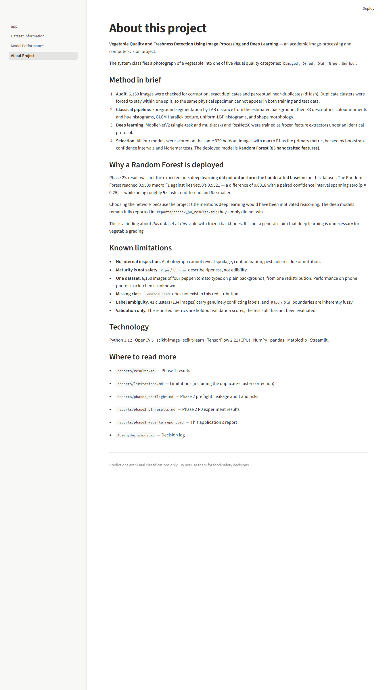

# Phase 3 — Web Application Report

**Vegetable Quality and Freshness Detection Using Image Processing and Deep Learning**

**Date:** 2026-11-15 · **Model:** A5 Random Forest (deployed) · **Platform:** Streamlit on
Python 3.12, CPU only

> **Correction added in Phase 4 (2026-11-15).** This report describes the Phase 3
> application, which resized images to **256 px** for feature extraction while the
> deployed model was trained on features extracted at **224 px**. The defect, its
> impact and the fix are documented in `reports/phase4_integrity_audit.md` §2; the
> serving pipeline now reproduces the training features exactly. Sections below that
> mention 256 px describe the Phase 3 state and are retained unedited as a historical
> record. Screenshots in `reports/screenshots/` were re-captured after the fix.

---

## 1. Summary

A working Streamlit application that classifies a vegetable photograph into one of
five visual quality categories, using the model selected by measurement in Phase 2.
Every displayed metric is read from a saved evaluation artefact; no prediction,
metric, screenshot or test result in this report is fabricated.

| Item | Result |
|---|---|
| Application starts | yes — `http://localhost:8501`, HTTP 200 |
| Real model in use | `models/final/rf_handcrafted.joblib` (A5, 200 trees, 83 features) |
| Prediction verified end-to-end | yes — real photograph, screenshot below |
| Test suite | **146 passed, 0 failed** |
| End-to-end inference | **19.7 ms** median (decode → preprocess → features → predict) |
| Phase 1 frozen artefacts | 12/12 checksums unchanged |
| Test split | **not used** |

## 2. Selected model, and why

Phase 2 evaluated four models on one shared holdout split of 929 images. The
Random Forest had the highest macro F1 and was statistically tied with the best
network:

| Run | Model | Macro F1 | 95 % CI | McNemar vs A5 | End-to-end |
|---|---|---:|---|---:|---:|
| **A5** | **Random Forest, 83 features** | **0.9539** | [0.9345, 0.9701] | — | **19.7 ms** |
| A3 | ResNet50, frozen | 0.9521 | [0.9342, 0.9676] | p = 0.253 | 302.8 ms |
| A4 | MobileNetV2 multi-task | 0.9401 | [0.9216, 0.9560] | p = 0.0011 | 172.8 ms |
| A2 | MobileNetV2, frozen | 0.9376 | [0.9206, 0.9525] | p < 0.0001 | — |

The A5−A3 difference is +0.0018 with a paired bootstrap CI of [−0.0207, +0.0233]:
indistinguishable. With accuracy unable to separate them, the decision fell to
cost — ~15× faster end-to-end, 15 MB vs 94 MB, 0.02 s load vs 1.37 s, and no
TensorFlow at serving time.

**Deep learning did not beat the handcrafted baseline on this dataset.** That is
the project's main empirical finding, not an inconvenience, and the deployed app
follows it rather than the title. Decision record: `Admin/decisions.md` D-012.

**Consequence:** the deployed model predicts **quality only**. The application
does not display a vegetable prediction, because producing one would require a
model that was not deployed.

## 3. Implemented features

### A. Home / dashboard
Project title, description, the deployed model and its validation macro F1 (read
from `p0_comparison.json`), supported vegetables and quality classes, and an
explicit "what this system does — and does not do" panel.

### B. Image upload
JPG/JPEG/PNG; checks extension, **magic bytes** (so a renamed file is caught),
size ≤ 15 MB, decodability, and dimensions within 64–10 000 px. Corrupt or
truncated files produce a readable error, never a traceback. Width, height, file
size and megapixels are displayed, and the uploaded image is previewed.

### C. Preprocessing
Shows original, 256×256 resize, and the segmented foreground with mask coverage.
Only the deployed pipeline runs: resize → LAB-distance segmentation → 83
descriptors. CLAHE, bilateral/median filtering and ImageNet normalisation are
deliberately **not** applied, because the deployed model never saw them. The
83-value feature vector is inspectable in an expander.

### D. Prediction
A `Predict quality` button runs the real artefact. Displays the predicted class,
its score, the runner-up, and all five class scores. Class indices come from the
artefact's stored class list, which is verified against `config.QUALITY_CLASSES` at
load time.

### E. Confidence visualisation
Horizontal bar chart of all five scores in percent, predicted class highlighted.
The caption states explicitly that Random Forest vote shares are **not calibrated
probabilities**.

### F. Explanation
Short plain-language text naming the class, stating that it reflects visual
patterns learned from the training set, and that it is not a food-safety verdict.
No feature-attribution claim is made, because no explainability method was
implemented or validated.

### G. Model information page
Architecture, tree count, feature count, input size, macro F1 / accuracy /
weighted F1 / 95 % CI, the full P0 comparison, per-class table, confusion matrix
image, an explicit three-row table separating grouped-CV / holdout / test, and the
measured latency benchmark. All values are read from artefacts.

### H. Dataset information page
Source, 6,150 images, 4 × 5 categories, split sizes, quality distribution, the
populated vegetable × quality matrix, and all six documented limitations —
including the corrected duplicate statistics (41 clusters / 134 images; the
732-image component was a chaining artefact).

### I. Prediction history
Session-scoped table (time, filename, quality, confidence, latency) capped at 20
entries, with a clear button. Images are never written to disk and no personal data
is collected.

## 4. Application architecture

```
website/
  app.py                          main flow: upload → preprocess → predict → history
  pages/
    1_Dataset_Information.py      dataset facts and limitations
    2_Model_Performance.py        metrics read from P0 artefacts
    3_About_Project.py            scope, method, honest limits
  components/
    upload.py                     source selection + validation feedback
    preprocessing_view.py         three-stage visual + feature inspector
    confidence_chart.py           matplotlib bar chart (pure function)
    prediction_display.py         result card, explanation, history table
  utils/
    paths.py                      single source of model/artefact paths
    validation.py                 upload checks and safe decoding
    image_processor.py            the training-time feature extraction, reused
    model_loader.py               load, contract verification, validated inference
    artefacts.py                  read-only access to evaluation/dataset JSON
    history.py                    session history (pure functions over a mapping)
    samples.py                    one held-out example per class
    cache.py                      Streamlit caching (model loaded once)
  styles/style.css
```

Preprocessing and prediction logic live in `website/utils/` and call the project's
own `src/` modules (`src.preprocessing.segment_vegetable`,
`src.features.handcrafted.extract_features`). Nothing is re-implemented for the
web layer, so the app cannot drift from training.

### Design notes

* **Model loaded once.** `st.cache_resource` holds the bundle for the process
  lifetime; a warm-up prediction avoids reporting cold-start cost. Reloading on
  every interaction would add ~20 ms and re-read 15 MB.
* **Serving-only tuning.** The artefact was fitted with `n_jobs=-1`, which costs
  ~18 ms of joblib overhead per single-row call. At load the app sets `n_jobs=1`,
  measured 26.7 ms → 8.2 ms for one row. Prediction values are unchanged; only
  parallelism differs.
* **Sample images and `?sample=N&predict=1` deep links.** Offered so a reviewer can
  exercise the pipeline without preparing a file, and so a prediction state is
  linkable. Sample images are held-out validation photographs whose true labels are
  shown to the user but not to the model.
* **Fail closed.** A model whose feature list or class order does not match the
  project raises `ModelUnavailable` and the UI explains what to do, rather than
  predicting from misaligned columns.

## 5. Preprocessing pipeline

Identical to the training-time extraction in `src.features.screening._load_one`:

1. decode upload (JPEG/PNG) → RGB uint8;
2. resize to **256×256** with `cv2.INTER_AREA` (source images are already 256², so
   this is a no-op for dataset images and a well-behaved downscale for phone photos);
3. `segment_vegetable` on BGR: foreground mask by LAB distance from the
   border-estimated background; if the mask is implausible (`ok = False`) it is
   discarded, exactly as in training;
4. `extract_features(rgb, mask)` → 83 values: colour moments, circular hue
   statistics, 12-bin hue histogram, colourfulness, excess-green/red, GLCM Haralick
   at three distances, uniform LBP at two radii, 7 shape descriptors;
5. NaN/inf scrubbing and `float32` cast;
6. `StandardScaler` → `RandomForestClassifier.predict_proba`.

A runtime assertion compares the produced feature keys against
`ALL_FEATURES`; drift raises instead of silently shifting columns.

## 6. Inference pipeline and guards

1. validate upload (type, magic bytes, size, decode, dimensions);
2. decode to RGB;
3. preprocess (above);
4. `predict_proba` on a `(1, 83)` row;
5. verify output shape, finiteness, range [0, 1] and sum ≈ 1;
6. map indices through the artefact's class list;
7. render result, chart, explanation;
8. append to session history.

Rejected conditions: empty upload, unsupported extension, non-image bytes, corrupt
or truncated image, image below 64 px or above 10 000 px, file above 15 MB, feature
vector of wrong shape, NaN/inf features, malformed probability vector.

## 7. Screenshots

All captured from the running application with local Chrome via Playwright
(`tools/capture_screenshots.py`). The remote preview panel could not display the app
because that browser is not on the machine serving `localhost`.

### Landing page



### Prediction — full flow

Sample image selected, preprocessing shown, prediction produced by the real model.



### Prediction — result detail

All five scores, the explanation, and the session history entry.



### Dataset information



### Model performance



### About



## 8. Test results

```
146 passed in 8.80s
```

66 new tests were added in Phase 3 (80 existed from Phases 1–2):

| File | What it locks down |
|---|---|
| `test_web_validation.py` | valid JPEG/PNG, uppercase extensions, empty upload, unsupported extension, missing extension, extension spoofing, corrupt and truncated files, 16 px images, 12 001 px images, oversized files, metadata reporting |
| `test_web_preprocessing.py` | 256² output, RGB channel order preserved, original untouched, 83 features in canonical order, finiteness, displayed values equal model input, overlay shape/dtype, flat-image robustness, no normalisation applied |
| `test_web_inference.py` | artefact present, feature and class contracts enforced, reversed class order rejected, truncated feature list rejected, probability sum/shape/finiteness/range validated, wrong row count, NaN and inf features, malformed model output, real-photo end-to-end |
| `test_web_app.py` | all four pages render without exception via `AppTest`, uploader present, no prediction before upload, full upload→predict→history flow in app order, history cap and clearing, invalid input never reaches the model |

Two genuine bugs were found by this work and fixed:

1. **Mask pixel count** displayed 7,335,330 for a 65,536-pixel image — a uint8 mask
   was summed (`255 × pixels`) instead of counted. Fixed with `np.count_nonzero`,
   and a regression assertion (`≤ 256²`) added.
2. **Section numbering** repeated "4" for both *Run the model* and *Result*.

A third was found by measurement: single-row inference was 26.7 ms because of
`n_jobs=-1`; corrected to 8.2 ms (see §4).

## 9. Inference timing

Measured on this machine (i5-13450HX, 16 GB, CPU only, TensorFlow not used at
serving time). `evaluation/metrics/inference_latency.json`, 25 images, sequential:

| Stage | Median |
|---|---:|
| decode + resize | 1.4 ms |
| segmentation | 2.2 ms |
| feature extraction (83) | 9.2 ms |
| `predict_proba` (single row) | 6.7 ms |
| **end-to-end** | **19.7 ms** |

The running app reported 21 ms for the model call in the captured session
(UI-measured, includes its own timer overhead), consistent with the benchmark.

**Caveat:** timings vary run to run on this shared machine. An earlier benchmark of
the same code measured 44.3 ms end-to-end before the `n_jobs` fix, and ResNet50
measured 235 ms in one run and 303 ms in another. Figures are reported as measured,
not rounded toward the best result.

## 10. Known limitations

1. **Validation, not test.** All metrics are holdout-validation numbers. The 935-image
   test split has not been evaluated under the approved protocol, and the app shows
   no test figure.
2. **No vegetable identity.** The deployed model cannot produce one.
3. **Uncalibrated scores.** Vote shares are not probabilities of correctness.
4. **`Damaged` is weak** — 46 validation images; recall 0.8478.
5. **`Ripe ↔ Old` confusion** dominates errors and coincides with 41 genuinely
   ambiguous duplicate clusters.
6. **Domain shift untested.** The app works on any upload, but performance on phone
   photographs in a kitchen is unknown; the dataset is plain-background studio-style
   imagery.
7. **Segmentation fallback.** When segmentation fails, shape features are zeroed and
   texture is measured over the full frame — the same behaviour as training, but less
   informative. The UI states this.
8. **`Tomato/Dried` cannot be predicted** — the class does not exist in this corpus.
9. **Single seed, single split.** Ranking stability across seeds was not measured.

## 11. Running the application

```bash
cd website
../.venv/Scripts/python.exe -m streamlit run app.py
```

Open <http://localhost:8501>. To run from the project root instead:

```bash
.venv/Scripts/python.exe -m streamlit run website/app.py
```

Requirements: the venv from `requirements.txt`, and the artefact at
`models/final/rf_handcrafted.joblib` (regenerate with
`python -m src.training.train --run-id A5`, 0.65 s).

Screenshots (optional):

```bash
.venv/Scripts/python.exe tools/capture_screenshots.py   # needs the app running
```

## 12. Verification performed

| Check | How | Result |
|---|---|---|
| App starts and serves | `curl` → HTTP 200, `/_stcore/health` → ok | pass |
| Pages render | `AppTest` on all four scripts | pass, no exceptions |
| In-app navigation | Playwright clicks sidebar links | pass, no HTTP errors |
| Real prediction | screenshot of `Damaged 62.5%` on a held-out image | pass |
| Probability validity | unit tests + runtime validation | pass |
| Invalid input safety | unit tests (corrupt, spoofed, oversized, tiny) | pass |
| History | unit tests + visible in screenshot | pass |
| Full test suite | `pytest tests/ -q` | 146 passed |
| Phase 1 artefacts | 12/12 SHA-256 unchanged | pass |
| Test split untouched | no code path calls `resolve_test` | pass |

**Not verified:** the app was not exercised on a phone photograph or a large
external image collection; only dataset images, synthetic images and crafted invalid
inputs. No accessibility or performance audit was run.

## 13. Deviations from the brief, and why

* **Vegetable output omitted.** The brief allows this when the selected model does
  not support it. Selecting A4 to obtain a vegetable head would have meant deploying
  a model that is significantly worse at the primary task (p = 0.0011).
* **A "sample image" control and `?sample=` deep links were added.** They let a
  reviewer exercise the real pipeline without preparing a file, and made automated
  evidence capture possible. They do not bypass validation or inference.
* **`playwright` added to the environment** (not to `requirements.txt`'s runtime
  section) purely for screenshot capture by `tools/capture_screenshots.py`. It uses
  the machine's installed Chrome; no browser was downloaded.
* **`n_jobs=1` at load time.** A serving optimisation, not a model change.
